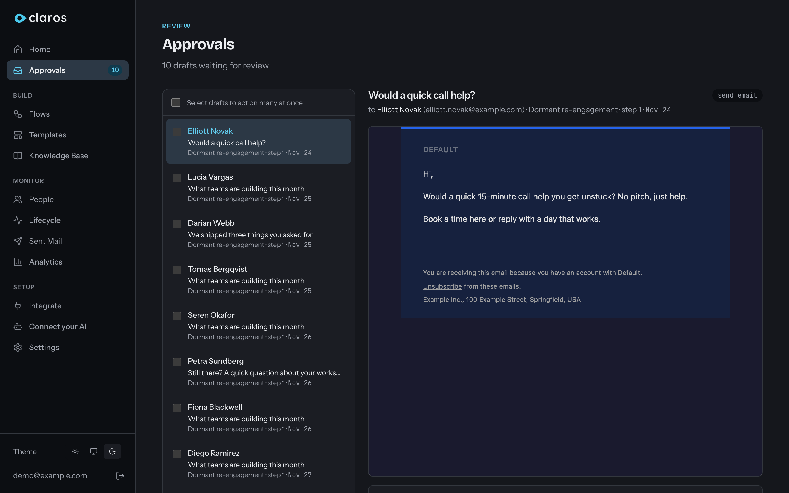
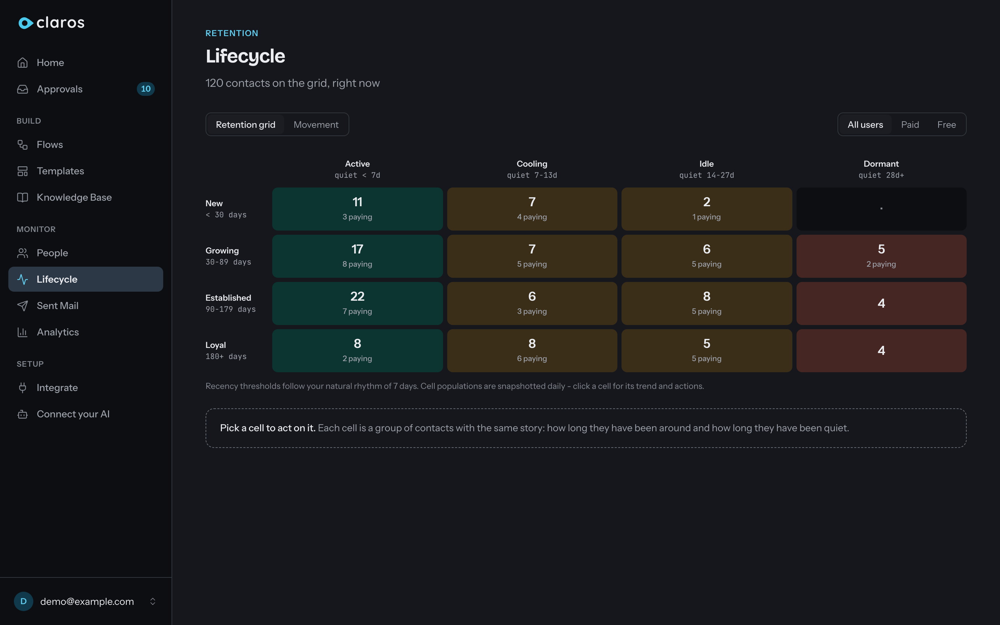

# Claros

**The open-source lifecycle email engine.** Your data, your transport, your LLM.

An AI-native alternative to Customer.io, Loops, and Mautic. Flows are written in plain language, compiled once by an LLM into a deterministic execution plan, and run by a deterministic engine. Self-host it with Postgres (one Docker image, one database, no Redis, no Kafka, no message broker) or on Cloudflare Workers + D1. One instance can serve several products.

[](https://github.com/claroshq/claros/actions/workflows/check.yml)
[](./LICENSE)


## Why it is different

**Flows are prompts, compiled once.** There is no drag-and-drop builder. You describe the flow ("welcome them, nudge them if they have not activated in 2 days, stop when they do"), the LLM compiles it into an inspectable plan, and the engine executes that plan deterministically. The AI never touches timing, targeting, or the send path.

**Everything AI-written waits for a human.** Generated emails queue in an approval inbox. You approve, reject, or let a trusted flow auto-send. The AI drafts; you publish.



**Your stack, your keys.** Emails go through your Resend or SMTP account, or Cloudflare Email Service for transactional mail. AI runs against your OpenAI-compatible endpoint (OpenAI, Anthropic, Gemini, Groq, Ollama). The only infrastructure is Postgres, or your Cloudflare account on the Workers install. Nothing phones home.

**A retention grid, not a vanity dashboard.** Contacts are bucketed by tenure and recency into a 4x4 grid. Each cell is an audience you can act on: create a flow, see who is there, watch the trend. The grid adapts to your product's natural rhythm.



## Get running

Two install options run the same HTTP API and engine. Pick one.

| Docker + Postgres | Cloudflare Workers + D1 |
|---|---|
| `git clone https://github.com/claroshq/claros.git && cd claros`<br>`docker compose run --rm install`<br>`docker compose up` | `npx @claroshq/claros deploy --domain claros.example.com` |
| Needs Docker; the compose stack bundles Postgres 16 + pgvector, or point it at your own Postgres | Needs a Cloudflare account; creates the D1 database, queues, secrets and Worker for you |
| Upgrade: `git pull`, `docker compose build`, `docker compose up` (migrations run on boot) | Upgrade: `npx @claroshq/claros upgrade` |
| [Quickstart](docs/guide/QUICKSTART.md), [Installation](docs/guide/INSTALLATION.md) | [Install on Cloudflare Workers + D1](docs/install/cloudflare.md) |

Either way, open the claim URL printed at the end, enter your email, and you are the owner. The **[Quickstart](docs/guide/QUICKSTART.md)** walks through the rest: connect a transport, activate the library flow, send a test event, and receive a real email - all from the browser. [Architecture](docs/architecture.md) lists the differences between the two backends.

### What's new in 0.8

The Cloudflare Workers + D1 install option, multi-product instances, topics and consent, several transports per product, operational alerts, admin keys and config as code, signed webhooks and an analytics sink, date triggers, context sources, knowledge base v2, the `choose` step and send-history import. Postgres installs upgrade in place. See the [CHANGELOG](CHANGELOG.md) for the full list and the upgrade notes.

## What it does

- **Lifecycle state machine** - 7 contact states (`signed_up` through `resurrected`) with engagement depth scoring and a payment overlay. Event-driven and time-driven transitions
- **Prompt-defined flows** - compiled to deterministic plans. Triggers: events, lifecycle transitions, retention-grid and lifecycle segments, contact dates (`date_property`, `date_schedule`) and manual enrollment. Steps with delays, conditions (`all` / `any` / `not`, traits, send history), send windows, exit conditions, context sources and the `choose` step. See [Flows](docs/guide/FLOWS.md)
- **Brain** - compile, decide, draft, assess, choose. Real LLM calls to any OpenAI-compatible endpoint, only at compile time and content time, never in timing, targeting or the send path
- **Approval queue** - AI-drafted messages are held for human review by default; edit, regenerate, cancel or exclude a person; per-flow auto-approve when you trust it
- **Event ingestion** - Segment-compatible `/v1/track`, `/v1/identify`, `/v1/batch`. Publishable and secret API keys, rate limits, browser snippet at `/claros.js`
- **Multi-product instances** - one install serves several products, each with its own contacts, flows, settings, keys and team; instance admins manage them all. See [Products](docs/guide/PRODUCTS.md)
- **Transports** - Resend (with open/click/bounce webhooks), generic SMTP (including the Amazon SES SMTP endpoint) and Cloudflare Email Service (transactional mail only). Several transports per product, routed by topic kind. See [Transports](docs/guide/TRANSPORTS.md)
- **Topics and consent** - marketing, lifecycle and transactional topics with per-topic unsubscribe. See [Topics](docs/guide/TOPICS.md)
- **Compliance built in** - RFC 8058 one-click unsubscribe built in for lifecycle and marketing mail, a CAN-SPAM postal footer on every outgoing email, suppression list enforced before everything
- **Throttle and send windows** - per-contact frequency caps, quiet hours, per-flow critical bypass
- **Knowledge base** - entries with categories, pinning and per-contact deduplication, injected into compile and draft prompts; pgvector similarity on Postgres, full-text search on D1; import from a file. See [Knowledge base](docs/guide/KB.md)
- **Config as code and admin keys** - one JSON file of flows, templates, topics, routing, settings and webhooks, applied with `claros apply`; scoped admin keys for the management API. See [Config as code](docs/guide/CONFIG.md) and [API keys](docs/guide/API_KEYS.md)
- **Webhooks and analytics sink** - signed outbound webhooks (Standard Webhooks) and flow and email events to StatsRaven or your own endpoint. See [Webhooks](docs/guide/WEBHOOKS.md)
- **Alerts and health** - dead jobs, send and webhook errors and missing configuration mailed to an instance admin, plus a Health page. See [Alerts](docs/guide/ALERTS.md)
- **Dashboard** - React SPA: Flows, Approvals, People, Lifecycle, Analytics, Knowledge Base, Settings, Integrate. Light and dark themes
- **Operator CLIs** - in the Docker image: guided setup, login links, transport/LLM configuration, user recovery, deployment diagnostics. `npx @claroshq/claros`: deploy, upgrade and diagnose a Cloudflare install, apply config, import knowledge base entries and send history

### Not yet built

- Calendar triggers not tied to a contact date (flows enroll on events, lifecycle transitions, segments, contact dates and manual enrollment today)
- SES API-mode transport and non-Resend feedback webhooks (SES works today through its SMTP endpoint)
- Knowledge base file upload and site crawl
- Anonymous identity stitching (contacts key on `userId` today)
- Moving an existing Postgres install to D1 (Postgres installs stay on Postgres and upgrade in place)

## Documentation

| Document | What it covers |
|---|---|
| [Quickstart](docs/guide/QUICKSTART.md) | Three commands to a running install, then a real email via the browser |
| [Architecture](docs/architecture.md) | Components, the two install options, capability differences between backends |
| [Installation and Configuration](docs/guide/INSTALLATION.md) | Docker + Postgres: every run mode, every environment variable and setting, migrations, upgrading, backups |
| [Install on Cloudflare Workers + D1](docs/install/cloudflare.md) | `npx @claroshq/claros deploy`, bindings, upgrades, product hosts, local trial with `wrangler dev` |
| [Deployment](docs/guide/DEPLOYMENT.md) | External Postgres, multiple instances, the role split, secrets that must match |
| [Concepts and Guides](docs/guide/CONCEPTS.md) | The model: events, contacts, compilation, approvals, content modes. Task guides |
| [Flow Prompt Library](docs/guide/FLOW-PROMPTS.md) | Working prompts to paste into the flow editor |
| [Ingestion](docs/guide/INGESTION.md) | Sending events: curl, browser snippet, server SDKs, Segment compatibility, GTM |
| [Flows](docs/guide/FLOWS.md), [Config as code](docs/guide/CONFIG.md), [Products](docs/guide/PRODUCTS.md), [Topics](docs/guide/TOPICS.md), [Transports](docs/guide/TRANSPORTS.md) | Triggers and step fields, the config file, multi-product instances, consent, sending |
| [API keys](docs/guide/API_KEYS.md), [Webhooks](docs/guide/WEBHOOKS.md), [Approvals](docs/guide/APPROVALS.md), [Alerts](docs/guide/ALERTS.md), [Knowledge base](docs/guide/KB.md), [Import](docs/guide/IMPORT.md) | Integrating with your product and operating an instance |
| [FAQ and Troubleshooting](docs/guide/FAQ.md) | Lost admin access, secrets, email not sending, AI features idle, backups, data egress |
| [Contributing](CONTRIBUTING.md) | Issues, pull requests, running the checks locally |
| [Security](SECURITY.md) | Vulnerability reporting |

Changes are recorded in [CHANGELOG.md](CHANGELOG.md) and on the [releases page](https://github.com/claroshq/claros/releases).

## Development (from source)

Requires Node.js 22+ (with npm) and Postgres 16 with pgvector.

```bash
npm install
npm run db:migrate   # apply migrations to DATABASE_URL from .env
npm run dev          # API on :3000 (watch mode), dashboard dev server on :5173
```

Details and the production image are in [Installation and Configuration](docs/guide/INSTALLATION.md).

## License

MIT - see [LICENSE](./LICENSE). Bug reports welcome in [GitHub Issues](https://github.com/claroshq/claros/issues).
