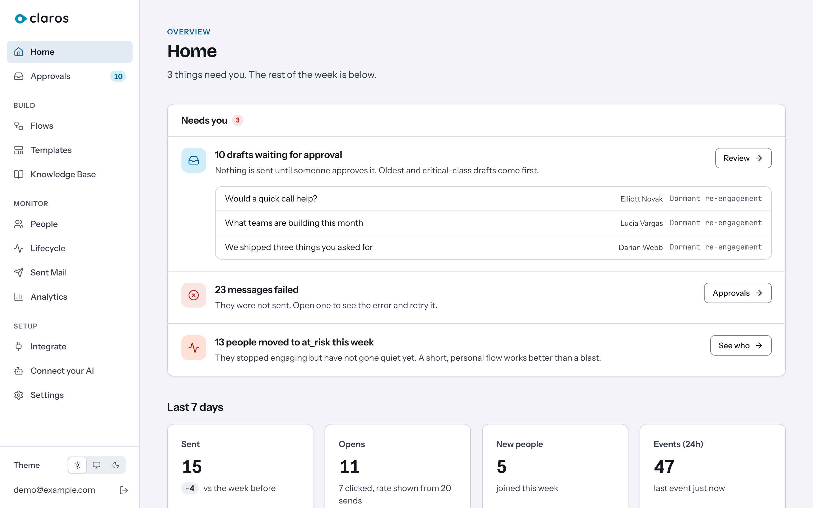
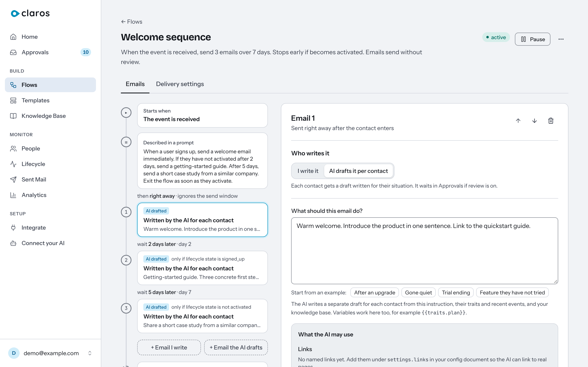
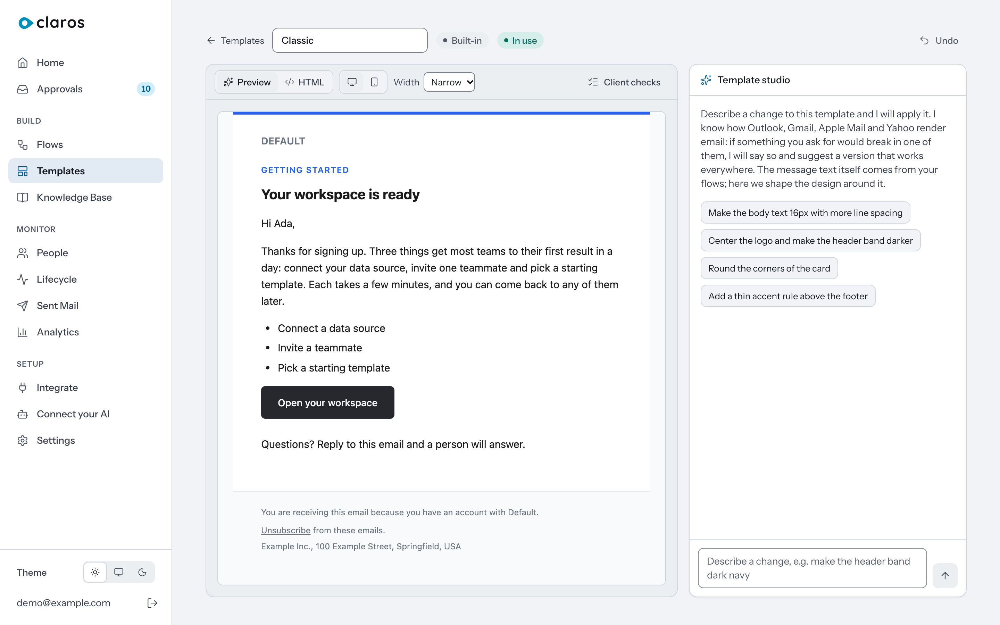

# Claros

**The open-source lifecycle email engine.** Your data, your transport, your LLM.

An AI-native alternative to Customer.io, Loops, and Mautic. Flows are written in plain language, compiled once by an LLM into a deterministic execution plan, and run by a deterministic engine. Self-host it with Postgres (one Docker image, one database, no Redis, no Kafka, no message broker) or on Cloudflare Workers + D1. One instance can serve several products.

[](https://github.com/claroshq/claros/actions/workflows/check.yml)
[](./LICENSE)



## Why it is different

**Flows are prompts, compiled once.** There is no drag-and-drop builder. You describe the flow ("welcome them, nudge them if they have not activated in 2 days, stop when they do"), the LLM compiles it into an inspectable plan, and the engine executes that plan deterministically. The AI never touches timing, targeting, or the send path.

The dashboard shows the compiled flow as a timeline: what starts it, each email with its wait, what ends it early. Open an email to write fixed copy in a code editor with a live preview, or to give the AI its instruction, examples and the links and knowledge base entries it may use. New flows start from an example (welcome, onboarding, trial ending, payment failed, win back, at-risk check-in), from a description, or blank.



**Everything AI-written waits for a human.** Generated emails queue in an approval inbox. You approve, reject, edit or regenerate, or let a trusted flow auto-send. The preview shows the mail as the recipient will see it, in the product's template. The AI drafts; you publish.


**Guardrails on what the AI writes.** Drafts may only use the product's named links (any other URL fails the draft), follow find/replace and forbidden-phrase rules, and stay under a daily token budget. An assess step drops messages that are not worth sending. A step can limit itself to one call to action.

**Templates you edit by talking to them.** Pick one of seven built-in email templates (narrow or wide), open it in the template studio and say what you want: "center the logo", "make the header band dark navy", "16px body text". The preview updates as each change lands. The assistant only works on that template and knows how Outlook, Gmail, Apple Mail and Yahoo render email: ask for something that would break in one of them (a CSS background photo, a flexbox row) and it tells you what would happen where and offers a version that works everywhere. Every template keeps the unsubscribe footer, and deterministic client checks run on every change.



**Your stack, your keys.** Emails go through your Resend or SMTP account, or Cloudflare Email Service for transactional mail. AI runs against your OpenAI-compatible endpoint (OpenAI, Anthropic, Gemini, Groq, Ollama). The only infrastructure is Postgres, or your Cloudflare account on the Workers install. Nothing phones home.

**A retention grid, not a vanity dashboard.** Contacts are bucketed by tenure and recency into a 4x4 grid. Each cell is an audience you can act on: create a flow, see who is there, watch the trend. The grid adapts to your product's natural rhythm.


## Several products, one instance

One Claros install serves as many products as you run. Each product is fully separate: its own contacts and events, flows and templates, topics and consent, transports and routing, brand, knowledge base, API keys and team. The same email address in two products is two contacts, and nothing crosses between them.

- **People**: one login per person, with a role per product (owner or member). Instance admins manage the install and act as owner in every product.
- **Dashboard**: with two or more active products it opens on a product picker; the sidebar switcher moves between them.
- **API**: ingestion keys belong to one product. Dashboard sessions and instance keys (`clr_ik_`) pick the product with the `X-Claros-Product: <slug>` header. Instance keys script the install from CI: create products, give each an admin key, set up its transports.
- **Archiving**: an archived product stays readable, refuses ingestion with `403` and sends nothing until it is unarchived.

Products work the same on both runtimes. See [Products](docs/guide/PRODUCTS.md).

## Get running

Two install options run the same HTTP API and engine. Pick one.

| Docker + Postgres | Cloudflare Workers + D1 |
|---|---|
| `git clone https://github.com/claroshq/claros.git && cd claros`<br>`docker compose run --rm install`<br>`docker compose up` | `npx @claroshq/claros deploy --domain claros.example.com` |
| Needs Docker; the compose stack bundles Postgres 16 + pgvector, or point it at your own Postgres | Needs a Cloudflare account; creates the D1 database, queues, secrets and Worker for you |
| Upgrade: `git pull`, `docker compose build`, `docker compose up` (migrations run on boot) | Upgrade: `npx @claroshq/claros upgrade` |
| [Quickstart](docs/guide/QUICKSTART.md), [Installation](docs/guide/INSTALLATION.md) | [Install on Cloudflare Workers + D1](docs/install/cloudflare.md) |

Either way, open the claim URL printed at the end, enter your email, and you are the owner. The **[Quickstart](docs/guide/QUICKSTART.md)** walks through the rest: connect a transport, activate the library flow, send a test event, and receive a real email - all from the browser. [Architecture](docs/architecture.md) lists the differences between the two backends.

### What's new in 0.8

- **0.8.0**: the Cloudflare Workers + D1 install option, multi-product instances, topics and consent, several transports per product, operational alerts, admin keys and config as code, signed webhooks and an analytics sink, date triggers, context sources, knowledge base v2, the `choose` step and send-history import
- **0.8.4 to 0.8.7**: `engagement_events` (which events count as activity), brand logo upload, the dashboard product picker, an embedding provider separate from the LLM provider, knowledge base search without embeddings
- **0.8.8 to 0.8.10**: email templates and the template studio, the flow editor redesign, an email template per flow, notes, topic switches and delete / exclude actions on a person's page
- **0.8.11**: importing event history and recomputing lifecycle state from it, for products that move to Claros with existing users

Postgres installs upgrade in place; Workers installs run `npx @claroshq/claros upgrade`. See the [CHANGELOG](CHANGELOG.md) for the full list and the upgrade notes.

## What it does

- **Lifecycle state machine** - 7 contact states (`signed_up` through `resurrected`) with engagement depth scoring and a payment overlay. Event-driven and time-driven transitions; `engagement_events` chooses which events count as activity
- **Prompt-defined flows** - compiled to deterministic plans. Triggers: events, lifecycle transitions, retention-grid and lifecycle segments, contact dates (`date_property`, `date_schedule`) and manual enrollment. Steps with delays, conditions (`all` / `any` / `not`, traits, send history), send windows, exit conditions, context sources and the `choose` step. Each email is fixed copy or AI-drafted per contact. Edited as a timeline in the dashboard or as JSON in a config file. See [Flows](docs/guide/FLOWS.md)
- **Brain** - compile, decide, draft, assess, choose. Real LLM calls to any OpenAI-compatible endpoint, only at compile time, content time and in the template studio, never in timing, targeting or the send path
- **Email templates and the template studio** - seven built-in templates (`classic`, `letter`, `banner`, `compact` narrow; `wide`, `broadsheet`, `canvas` wide), custom copies, and a chat that edits a template with mail client knowledge built in; client checks for Outlook, Gmail, Apple Mail and Yahoo without the LLM. One template per product, and a flow can send in its own. See [Email templates](docs/guide/TEMPLATES.md)
- **Branding and language** - logo (uploaded and served by Claros, or an external URL), accent color, Reply-To, postal address; the product `locale` sets the drafting language and the language of the mail footer and unsubscribe pages (English and Spanish)
- **Approval queue** - AI-drafted messages are held for human review by default; edit, regenerate, cancel or exclude a person; per-flow auto-approve when you trust it; keyboard shortcuts; an optional daily digest of waiting approvals to the product's owners. See [Approvals](docs/guide/APPROVALS.md)
- **AI guardrails** - named links and a link allowlist, `text_rules` (find/replace and forbidden phrases), product guidelines, `single_cta`, a daily LLM token budget and the assess value gate
- **Event ingestion** - Segment-compatible `/v1/track`, `/v1/identify`, `/v1/batch`. Publishable and secret API keys, rate limits, browser snippet at `/claros.js`
- **Multi-product instances** - one install serves several products, each with its own contacts, flows, topics, transports, brand, keys and team; per-product memberships, instance admins, instance keys (`clr_ik_`) and the `X-Claros-Product` header; a product picker in the dashboard; archive and unarchive. See [Products](docs/guide/PRODUCTS.md)
- **Transports** - Resend (with open/click/bounce webhooks), generic SMTP (including the Amazon SES SMTP endpoint) and Cloudflare Email Service (transactional mail only). Several transports per product, routed by topic kind. See [Transports](docs/guide/TRANSPORTS.md)
- **Topics and consent** - marketing, lifecycle and transactional topics with per-topic unsubscribe. See [Topics](docs/guide/TOPICS.md)
- **Compliance built in** - RFC 8058 one-click unsubscribe built in for lifecycle and marketing mail, a CAN-SPAM postal footer on every outgoing email, suppression list enforced before everything, a suppression API, and erasing a person (with their events and messages) in one product or across the instance
- **Throttle and send windows** - per-contact frequency caps, quiet hours, per-flow critical bypass; `scheduled` flows run beside the nurture flow and still respect caps and windows
- **Link tracking** - UTM parameters and a message id added to links on the product's domains at send time (never on unsubscribe or footer links)
- **Knowledge base** - entries with categories, pinning and per-contact deduplication, injected into compile and draft prompts; semantic search with an optional embedding provider (pgvector on Postgres), word matching without one; a guided import in the dashboard (Markdown, text, CSV, JSONL or JSON files, with a dry run before anything is written) and a bulk API (`POST /v1/kb/import`, admin key scope `kb`) to keep it in sync from your own system. See [Knowledge base](docs/guide/KB.md)
- **Config as code and admin keys** - one JSON file of flows, templates, topics, routing, settings and webhooks, applied with `claros apply`; scoped admin keys for the management API. See [Config as code](docs/guide/CONFIG.md) and [API keys](docs/guide/API_KEYS.md)
- **Webhooks and analytics sink** - signed outbound webhooks (Standard Webhooks) and flow and email events to StatsRaven or your own endpoint. See [Webhooks](docs/guide/WEBHOOKS.md)
- **Alerts and health** - dead jobs, send and webhook errors and missing configuration mailed to an instance admin, plus a Health page. See [Alerts](docs/guide/ALERTS.md)
- **Dashboard** - React SPA: Home, Approvals, Flows, Templates, Knowledge Base, People, Lifecycle, Sent Mail, Analytics, Integrate, Settings (including Health for instance admins). A person's page shows the timeline, topic switches, team notes and delete / exclude actions. Light and dark themes
- **History import** - bring a product's earlier sends (counted for caps, re-entry and history conditions) and its event history, then recompute each contact's lifecycle state from those events without sending anything or firing flows. See [Importing history](docs/guide/IMPORT.md)
- **Operator CLIs** - in the Docker image: guided setup, login links, transport/LLM configuration, user recovery, deployment diagnostics. `npx @claroshq/claros`: deploy, upgrade and diagnose a Cloudflare install, apply config, import knowledge base entries, send history and event history (with a lifecycle recompute)

### Not yet built

- Calendar triggers not tied to a contact date (flows enroll on events, lifecycle transitions, segments, contact dates and manual enrollment today)
- SES API-mode transport and non-Resend feedback webhooks (SES works today through its SMTP endpoint)
- Knowledge base import from PDF or Word documents, and site crawl
- Anonymous identity stitching (contacts key on `userId` today)
- Moving an existing Postgres install to D1 (Postgres installs stay on Postgres and upgrade in place)

## Documentation

| Document | What it covers |
|---|---|
| [Quickstart](docs/guide/QUICKSTART.md) | Three commands to a running install, then a real email via the browser |
| [Architecture](docs/architecture.md) | Components, the two install options, capability differences between backends |
| [Installation and Configuration](docs/guide/INSTALLATION.md) | Docker + Postgres: every run mode, every environment variable and setting, migrations, upgrading, backups |
| [Install on Cloudflare Workers + D1](docs/install/cloudflare.md) | `npx @claroshq/claros deploy`, bindings, upgrades, product hosts, local trial with `wrangler dev` |
| [Deployment](docs/guide/DEPLOYMENT.md) | External Postgres, multiple instances, the role split, secrets that must match |
| [Concepts and Guides](docs/guide/CONCEPTS.md) | The model: events, contacts, compilation, approvals, content modes. Task guides |
| [Flow Prompt Library](docs/guide/FLOW-PROMPTS.md) | Working prompts to paste into the flow editor |
| [Ingestion](docs/guide/INGESTION.md) | Sending events: curl, browser snippet, server SDKs, Segment compatibility, GTM |
| [Flows](docs/guide/FLOWS.md), [Email templates](docs/guide/TEMPLATES.md), [Config as code](docs/guide/CONFIG.md), [Products](docs/guide/PRODUCTS.md), [Topics](docs/guide/TOPICS.md), [Transports](docs/guide/TRANSPORTS.md) | Triggers and step fields, the config file, multi-product instances, consent, sending |
| [API keys](docs/guide/API_KEYS.md), [Webhooks](docs/guide/WEBHOOKS.md), [Approvals](docs/guide/APPROVALS.md), [Alerts](docs/guide/ALERTS.md), [Knowledge base](docs/guide/KB.md), [Import](docs/guide/IMPORT.md) | Integrating with your product and operating an instance |
| [FAQ and Troubleshooting](docs/guide/FAQ.md) | Lost admin access, secrets, email not sending, AI features idle, backups, data egress |
| [Contributing](CONTRIBUTING.md) | Issues, pull requests, running the checks locally |
| [Security](SECURITY.md) | Vulnerability reporting |

Changes are recorded in [CHANGELOG.md](CHANGELOG.md) and on the [releases page](https://github.com/claroshq/claros/releases).

## Development (from source)

Requires Node.js 22+ (with npm) and Postgres 16 with pgvector.

```bash
npm install
npm run db:migrate   # apply migrations to DATABASE_URL from .env
npm run dev          # API on :3000 (watch mode), dashboard dev server on :5173
```

Details and the production image are in [Installation and Configuration](docs/guide/INSTALLATION.md).

## License

MIT - see [LICENSE](./LICENSE). Bug reports welcome in [GitHub Issues](https://github.com/claroshq/claros/issues).
