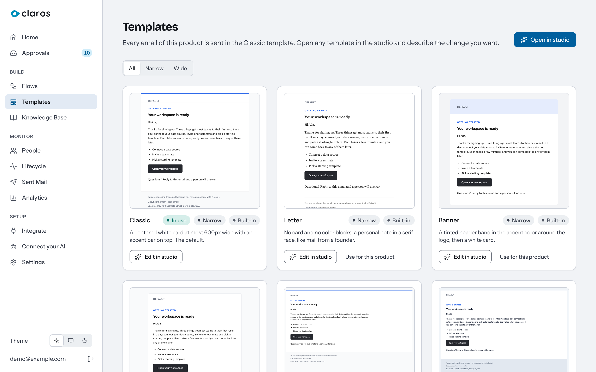
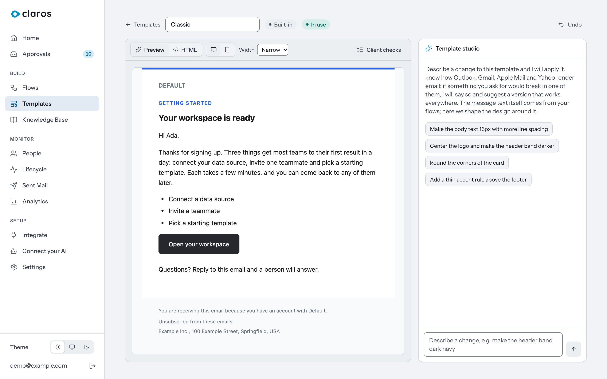

# Email templates and the template studio

An email template is the HTML document every email of a product is sent in: the page background, the header with the logo, the card or column the message sits in, and the footer with the unsubscribe link and postal address. The message text itself comes from your flows and arrives in the template's `{{body}}`.

Each product has a default template, and a flow can choose its own. Claros ships seven built-in templates, and you can change any of them, or your own copies, by describing what you want in the template studio.



## Built-in templates

| Key | Width | Design |
|---|---|---|
| `classic` | narrow | A centered white card at most 600px wide with an accent bar on top. The default. |
| `letter` | narrow | No card and no color blocks: a personal note in a serif face. |
| `banner` | narrow | A tinted header band in the accent color around the logo, then a white card. |
| `compact` | narrow | A tight bordered card at most 520px wide for receipts, codes and account notices. |
| `wide` | wide | The card fills the reading pane; paragraphs keep a 680px measure. |
| `broadsheet` | wide | Full-width header row over an accent rule, for updates and newsletters. |
| `canvas` | wide | Edge to edge white, no card and no frame. |

Narrow templates center a column and wrap it in an Outlook ghost table, because Outlook for Windows ignores `max-width`. Wide templates use `width="100%"` tables only; Claros gives body paragraphs a 680px measure so long lines stay readable, and on screens under 760px buttons become full width.

Every template follows the same email rules: tables for structure, inline styles, a system font stack, no background images, no web fonts, a dark mode block for the clients that honour it, and nothing that breaks when a client strips `<style>`.

## Choosing the template in use

On the Templates page, pick **Use for this product** on a template card. Over the API (owner session, or an admin key with the `config` scope):

```bash
curl -X PUT https://claros.example.com/v1/layouts/active \
  -H 'Content-Type: application/json' -H 'X-Claros-Product: acme' -b 'claros_session=...' \
  -d '{"template": "banner"}'
```

The choice is stored as `settings.brand.template`: a built-in key or the id of one of the product's own templates. It can also be set in the config document (`settings.brand.template`, see [Config as code](CONFIG.md)) and with `PATCH /v1/settings/tenant` (`brand.template`; `null` clears it).

Without `brand.template`, `brand.layout` decides as before: `"wide"` sends with `wide`, anything else with `classic`. A product that never chose a template sends exactly the HTML it sent before templates existed. If the template named in `brand.template` was deleted, the product falls back to `brand.layout` the same way.

The change applies to every email sent after it, including mail already approved and waiting to be sent: the template is applied at send time, around the stored message.

## A template per flow

A flow can send in a template other than the product's: open the flow, **Delivery settings**, **Email template**, and pick one. **Product default** (the first entry) follows the product's template, including later changes to it. The Templates page shows on each card how many flows use it.

Over the API, set `email_template` on `POST /v1/flows` or `PATCH /v1/flows/:id`: a built-in key or the id of one of the product's templates; `null` goes back to the product default. Other values answer `400`. In a config document the flow key is `email_template` (absent keeps the flow's current template, `null` clears it).

The template a message is sent in, at send time:

1. the flow's `email_template`, when it names a built-in template or a template of the product that still exists;
2. else the product's `settings.brand.template`;
3. else `brand.layout` (`wide`, or `classic`).

A custom template that a flow uses cannot be deleted (`409`, naming the flows); choose another template for those flows first. The Approvals preview renders each draft in the template its flow resolves to.

## The template studio



Open any template with **Edit in studio**. The preview shows the template with your brand settings and a sample message; the chat is docked beside it (below it on small screens).

1. Describe a change in plain words: "make the body text 16px", "center the logo", "make the header band dark navy", "round the corners of the card".
2. The preview is frosted while the change is applied, then shows the new version. The assistant says what it changed.
3. Keep going with more changes, or **Undo** the last one. **Desktop** and **Phone** switch the preview width; **HTML** shows the source, which you can also edit by hand.
4. **Save** (custom templates) or **Save as new template** (built-in templates, which never change) when it looks right. **Save and use** also makes it the product's template.

Nothing reaches your contacts until you save and the template is in use. The working copy and the chat stay in the browser tab until you save or discard them, so you can work on several templates side by side.

### What the assistant will and will not do

The assistant works on this one template and nothing else. Questions about how the template renders get an answer; anything else (general questions, other code, writing the email's text) gets a one-line refusal. The message text belongs to your flows; the assistant can change how text looks, not what it says.

It knows how the major mail clients render HTML. When a request would break the email in Outlook for Windows, Gmail, Apple Mail or Yahoo Mail, it does not apply it. It says what would happen in which client and proposes the closest version that works everywhere; **Apply the proposal** applies it. A few examples:

| You ask for | What happens |
|---|---|
| A background photo behind the header text | Proposed instead: Outlook for Windows does not show CSS background images without VML, and Gmail strips the positioning. The usual alternative is a full-width image above a solid color band. |
| Logo and links side by side with flexbox | Proposed instead: Outlook for Windows ignores flexbox. A two-cell table gives the same result everywhere. |
| A web font for the headings | Applied with a system font fallback, and the reply says that Gmail, Outlook for Windows and Yahoo show the fallback. |
| Rounded corners on the card | Applied; the reply notes that Outlook for Windows shows square corners. |
| Removing the unsubscribe footer | Refused: every email must carry the unsubscribe link and postal address. |

These are the rules the assistant is instructed to follow; a language model can still get one wrong. The client checks below do not depend on the model, and a template that breaks the save rules is never accepted from the assistant (it gets one chance to repair it, then the change is dropped).

The studio uses the product's LLM provider (Settings, AI providers), with the same model as flow compiles and drafts. Its tokens count toward the product's daily LLM usage. It runs only while you edit a template, never when mail is sent.

### Client checks

Every template is checked without the LLM, on every change and on save. **Client checks** in the studio lists the findings:

- **Blocks saving**: a template must contain `{{body}}` and `{{compliance_footer}}` exactly once, use only the placeholders below, be a full HTML document of at most 64 KB, and contain no scripts, event handlers, `javascript:` links, forms, frames or embedded objects.
- **Warning**: constructs some clients ignore, with the clients affected and the fix: flexbox, grid, CSS positioning, background images, SVG, web fonts, CSS variables, `max-width` without an Outlook ghost table, fixed widths over 700px, video and audio, `data:` images, `<button>` elements, templates over 40 KB.
- **Note**: polish that some clients drop: rounded corners and shadows in Outlook for Windows, animations, hover styles, `rgba()` colors, images without alt text, layout tables without `role="presentation"`, a missing `{{preheader}}` or viewport tag.

When an assistant change introduces a new finding, the chat message lists it.

## Placeholders

| Placeholder | Filled with |
|---|---|
| `{{body}}` | The message body. Required, exactly once. |
| `{{compliance_footer}}` | The unsubscribe link and the product's postal address. Required, exactly once. |
| `{{preheader}}` | The step's hidden inbox preview text, or nothing. Place it right after `<body>`. |
| `{{eyebrow}}` | The step's small label above the body as a `<p>`, or nothing. |
| `{{logo}}` | The logo ``, or the brand name as text when there is no logo. With a [dark-mode logo](INSTALLATION.md#dark-mode-logo), both images and a style block (added before `</head>`, or next to the logo when the template has no `<head>`) that shows the dark one in dark mode. |
| `{{logo_url}}` | The logo URL, or empty. |
| `{{brand_name}}` | The brand name (Settings, Branding), else the product name. |
| `{{accent_color}}` | The accent color. |
| `{{accent_soft}}` | The accent color mixed with white, for light bands and backgrounds. |
| `{{footer_text}}` | The footer line, by default "You are receiving this email because you have an account with ...". |

Placeholders are filled in one pass: text inside the message body is never read as a placeholder. Contact merge variables such as `{{contact.first_name}}` work in the message text, not in templates.

## API

All routes take the product from the session or the `X-Claros-Product` header like every dashboard route. A template is addressed by its ref: a built-in key or a custom template's id.

| Route | Role | Does |
|---|---|---|
| `GET /v1/layouts` | member, admin key `config` | Every template (`ref`, `kind`, `name`, `description`, `width`, `based_on`, `in_use`, `flow_count`) and `active`, the product's default ref. `?previews=true` adds `preview_html` per template. |
| `GET /v1/layouts/:ref` | member, admin key `config` | One template with its `source`, its `findings` and a `preview_html`. |
| `POST /v1/layouts` | owner, admin key `config` | Create a template: `name`, `width` (`narrow` or `wide`), `source`, optional `description` and `based_on`. `422` with `findings` when it cannot be saved. |
| `PUT /v1/layouts/:id` | owner, admin key `config` | Change `name`, `description`, `width` or `source` of a custom template. Built-in templates answer `409`. |
| `DELETE /v1/layouts/:id` | owner, admin key `config` | Delete a custom template. The template in use, and one a flow uses, answer `409`. |
| `PUT /v1/layouts/active` | owner, admin key `config` | `{"template": ref}`: use this template for the product. |
| `POST /v1/layouts/preview` | member | `{"source", "width"}`: the rendered sample and the findings, without saving. |
| `POST /v1/layouts/assist` | owner | One studio turn: `{"source", "width", "message", "history"}` where `history` is the earlier `{role, content}` turns. Answers `decision` (`applied`, `proposed`, `answered`, `off_topic` or `failed`), `reply`, the new `source` when applied, `findings`, `new_findings` and `preview_html`. `422` without an LLM provider. Nothing is stored. |

`GET /v1/capabilities` lists the feature `email_templates`. Templates behave the same on Postgres and D1; Workers installs need `npx @claroshq/claros upgrade` for the new table.
